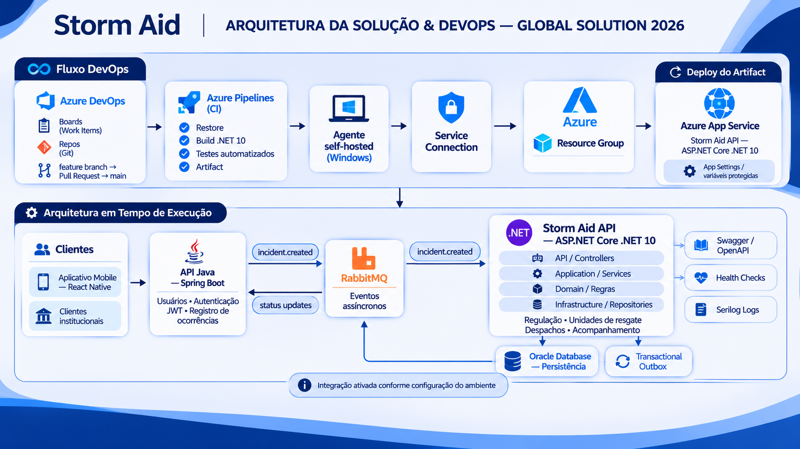

# Storm Aid — DevOps & Cloud Computing

## 1. Visão geral

Este repositório contém a implementação da infraestrutura em nuvem e do processo de integração e entrega contínua (CI/CD) da aplicação Storm Aid, desenvolvida para a Global Solution 2026/2 da FIAP.

O objetivo desta entrega é automatizar o processo de versionamento, validação, compilação, execução de testes e implantação da aplicação em ambiente cloud, utilizando os serviços Microsoft Azure e Azure DevOps.

O processo foi estruturado para permitir que alterações realizadas no código sejam verificadas automaticamente e, após integração na branch principal, disponibilizadas no ambiente de hospedagem.

---

## 2. Tecnologias utilizadas

| Tecnologia | Utilização |
|---|---|
| Azure DevOps | Gerenciamento do projeto, versionamento e automação |
| Azure Boards | Planejamento e acompanhamento de tarefas |
| Azure Repos | Repositório Git e controle de versão |
| Azure Pipelines | Automação de Build, testes e Deploy |
| Azure CLI | Provisionamento e gerenciamento da infraestrutura |
| Microsoft Azure | Plataforma de hospedagem em nuvem |
| Azure App Service | Hospedagem da API |
| .NET 10 | Plataforma utilizada na aplicação |
| Oracle Database | Persistência de dados |
| YAML | Definição das etapas da pipeline |

---

## 3. Arquitetura da solução

A arquitetura utiliza serviços do Azure para hospedar a aplicação e o Azure DevOps para automatizar o ciclo de desenvolvimento e implantação.

O fluxo de entrega é composto pelas seguintes etapas:

1. Gerenciamento das atividades por meio do Azure Boards.
2. Desenvolvimento em branches separadas da branch principal.
3. Versionamento das alterações utilizando Git e Azure Repos.
4. Criação de Pull Requests para revisão e integração do código.
5. Execução automatizada da pipeline de CI.
6. Restauração das dependências, compilação e execução dos testes.
7. Geração e publicação do artifact.
8. Execução da etapa de CD.
9. Implantação da aplicação no Azure App Service.

O provisionamento dos recursos de infraestrutura é realizado por meio de scripts Azure CLI armazenados no repositório.

---

## 🧭 Diagrama de arquitetura CI/CD




## 4. Pré-requisitos

Para executar e gerenciar o projeto, são necessários:

- Git instalado.
- .NET SDK 10.
- Azure CLI.
- Acesso ao projeto no Azure DevOps.
- Permissões necessárias na assinatura Azure.
- Configuração das variáveis de ambiente e credenciais necessárias para a aplicação.

---

## 5. Clonando o repositório

Clone o repositório utilizando o endereço disponibilizado no Azure Repos:

```bash
git clone https://Global-Solution-Grupo-BSL@dev.azure.com/Global-Solution-Grupo-BSL/Storm%20Aid%20-%20Grupo%20BSL/_git/Storm%20Aid%20-%20Grupo%20BSL
```

Acesse a pasta do projeto:

```bash
cd stormaid-devops-gs
```

Para consultar as branches disponíveis:

```bash
git branch -a
```

---

## 6. Execução e validação local

Antes de realizar alterações ou enviar código para o repositório, é possível validar a solução localmente.

### Restaurar dependências

```bash
dotnet restore
```

### Compilar a solução

```bash
dotnet build
```

### Executar os testes automatizados

```bash
dotnet test
```

Os testes automatizados também são executados durante o processo de integração contínua, permitindo validar as alterações antes da publicação.

---

## 7. Provisionamento da infraestrutura

A infraestrutura da aplicação utiliza recursos disponibilizados pela Microsoft Azure.

Os scripts de provisionamento estão organizados na pasta:

```text
/scripts
```

O provisionamento utiliza Azure CLI para criar ou verificar os recursos necessários ao ambiente.

### Autenticação no Azure

Para autenticar utilizando Azure CLI:

```bash
az login
```

Consultar a assinatura ativa:

```bash
az account show
```

Caso seja necessário selecionar uma assinatura específica:

```bash
az account set --subscription "SUBSCRIPTION_ID"
```

Os scripts devem ser executados conforme as instruções e parâmetros definidos em seus arquivos, respeitando o ambiente e a assinatura selecionados.

> Antes de executar qualquer script de infraestrutura, confirme a assinatura Azure selecionada e os nomes dos recursos para evitar alterações em ambientes incorretos.

---

## 8. Azure DevOps

O projeto utiliza Azure DevOps para centralizar o gerenciamento das atividades, código-fonte e processos automatizados.

### Azure Boards

Utilizado para registrar e acompanhar tarefas relacionadas ao desenvolvimento e à entrega.

Os Work Items permitem relacionar atividades às branches, commits e Pull Requests, mantendo a rastreabilidade das alterações.

### Azure Repos

Utilizado para armazenar o código-fonte e realizar o controle de versão por Git.

O fluxo de desenvolvimento utiliza branches para separar alterações e Pull Requests para revisar e integrar modificações na branch principal.

### Branch principal

A branch `main` é utilizada como branch principal do projeto.

As alterações devem ser realizadas em branches separadas e integradas por meio de Pull Requests, respeitando as políticas configuradas no Azure DevOps.

---

## 9. Processo de CI — Continuous Integration

A pipeline de integração contínua é definida por meio de um arquivo YAML versionado no repositório.

O processo automatiza as seguintes etapas:

1. Checkout do código-fonte.
2. Restauração das dependências.
3. Compilação da solução .NET.
4. Execução dos testes automatizados.
5. Preparação dos arquivos necessários para publicação.
6. Geração e publicação do artifact.

A CI permite validar o código e identificar possíveis falhas antes que a aplicação seja implantada no ambiente cloud.

---

## 10. Processo de CD — Continuous Deployment

Após a geração do artifact pela pipeline de CI, os arquivos gerados são utilizados no processo de entrega contínua.

A etapa de CD realiza a implantação da aplicação no Azure App Service utilizando a conexão configurada no Azure DevOps.

O processo automatizado reduz a necessidade de publicação manual e padroniza a entrega das alterações para o ambiente cloud.

---

## 11. Configuração de variáveis e credenciais

As configurações necessárias para execução e implantação são gerenciadas por meio de variáveis de ambiente e configurações protegidas no Azure DevOps e Azure App Service.

Credenciais, tokens, strings de conexão e outras informações sensíveis não devem ser armazenadas diretamente no código-fonte ou em arquivos versionados.

As variáveis utilizadas pelas pipelines devem ser configuradas de forma segura, utilizando os recursos de proteção disponíveis no Azure DevOps.

---

## 12. Acompanhamento das pipelines

As execuções podem ser acompanhadas pelo Azure DevOps em:

**Pipelines → Pipelines → Pipeline do projeto**

Na execução é possível consultar:

- Status do Build.
- Logs de cada etapa.
- Resultado da compilação.
- Resultado dos testes automatizados.
- Artifacts publicados.
- Status do Deploy.
- Histórico das execuções.

Uma execução concluída com sucesso indica que as etapas configuradas foram executadas sem falhas.

---

## 13. Ambiente de publicação

A aplicação é disponibilizada por meio do Azure App Service.

Após o processo de deploy, o ambiente pode ser acessado utilizando a URL pública configurada para o Web App.

A documentação da API pode ser acessada por meio do Swagger, quando habilitado no ambiente de publicação.

---

## 14. Fluxo de trabalho

O fluxo de desenvolvimento e entrega segue o processo:

```text
Azure Boards
     |
     v
Criação da tarefa
     |
     v
Feature Branch
     |
     v
Alteração no código
     |
     v
Commit e Push
     |
     v
Pull Request
     |
     v
Revisão e validação
     |
     v
Merge na main
     |
     v
Pipeline CI
     |
     +--> Restore
     +--> Build
     +--> Testes automatizados
     +--> Artifact
     |
     v
Pipeline CD
     |
     v
Azure App Service
     |
     v
Aplicação publicada
```

---

## 15. Organização dos arquivos relacionados à entrega

Os arquivos de infraestrutura e automação são mantidos no próprio repositório para facilitar a manutenção, rastreabilidade e reprodução do processo.

Estrutura relacionada à entrega:

```text
/
├── azure-pipeline.yml
├── scripts/
│   ├── scripts de provisionamento Azure CLI
│   └── script-bd.sql
└── código-fonte da aplicação
```

Os scripts e arquivos de pipeline devem ser versionados junto ao código-fonte do projeto.

---

## 16. Considerações finais

A implementação de DevOps no Storm Aid permite integrar o planejamento, o versionamento, a validação automatizada e a implantação em nuvem em um fluxo único.

A utilização do Azure DevOps e Microsoft Azure proporciona maior organização, rastreabilidade e padronização do processo de entrega, além de facilitar a identificação de falhas durante as etapas de compilação, testes e publicação.

Esta infraestrutura foi desenvolvida como parte da Global Solution 2026/2 — DevOps Tools & Cloud Computing, da FIAP.